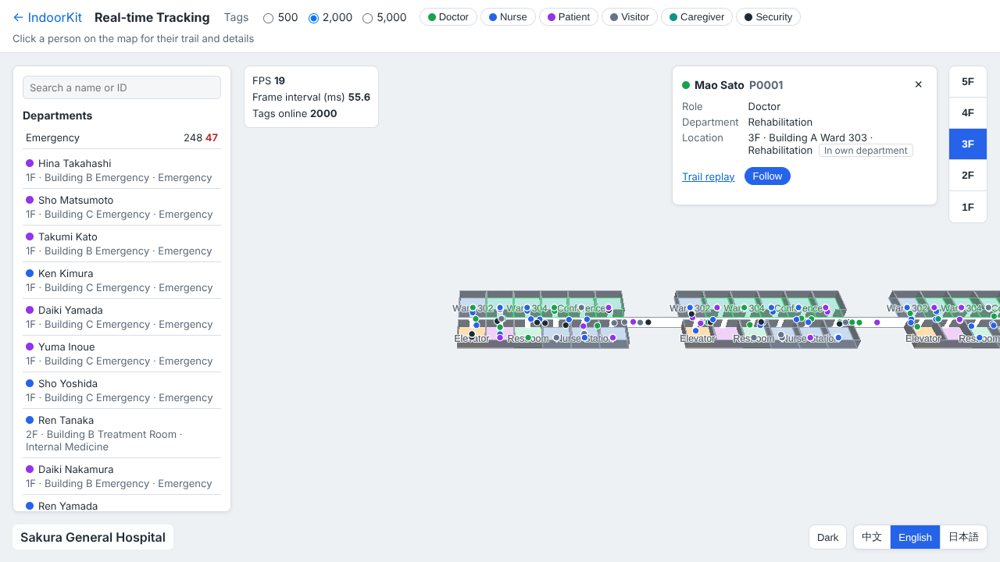
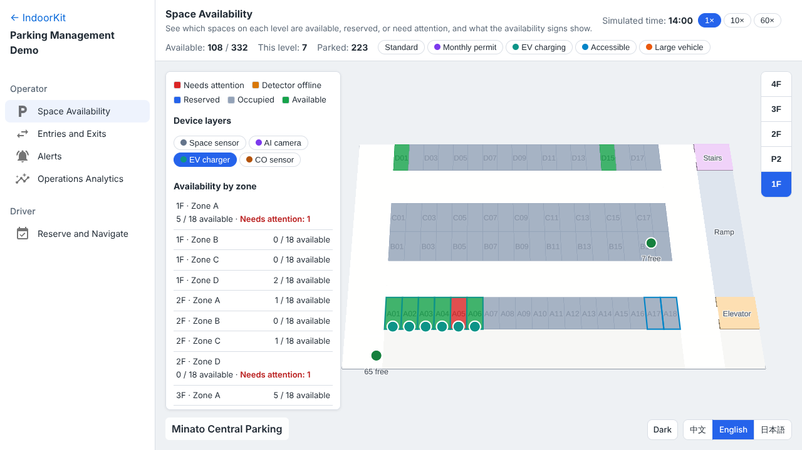
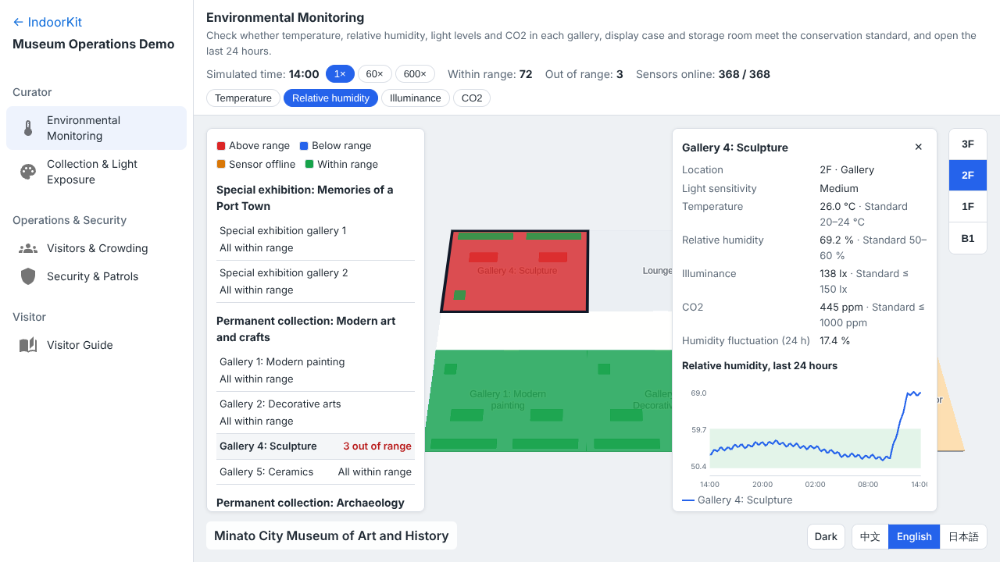

# IndoorKit

[English](README.md) | [简体中文](README.zh-CN.md) | **日本語**

IndoorKit は、ブラウザで動く屋内地図 SDK です。TypeScript で開発し、MapLibre GL JS をベースにしています。IMDF 形式の施設データを読み込み、フロアと部屋を 2.5D で描画します。フロア切替、マーカー、リアルタイム位置、ジオフェンス、ヒートマップ、ルートなどの機能はプラグインとして提供し、プラグインは型が付いていて、作ったリソースを自分で解放します。

**オンラインデモ：<https://vivi-shiki.github.io/IndoorKit/?lang=ja>**

## 特徴

- **プラグイン機構。** `definePlugin` でプラグインと依存関係を宣言すると、依存順に読み込まれ、`indoor.plugins` から型付きの API を使えます。
- **メモリリークを起こさない設計。** プラグインが作ったソース、レイヤー、リスナー、タイマー、Worker はすべて `ResourceTracker` に登録され、`destroy()` で作成と逆順に解放されます。メモリ回帰テストで JS ヒープ、Worker、解放漏れを確認します。
- **オープンなデータ形式。** 施設データは IMDF（OGC コミュニティ標準）で、要素間の参照や ID の一意性も含めて zod で検証します。部門や駐車エリアなど標準外のデータは、型付きの拡張ファイルとしてそれぞれ検証します。
- **データからスタイルを生成。** 部屋の色と高さは部屋の種類とテーマで決まり、壁と部屋は 3D モデルなしで立体化します。言語とテーマは地図を作り直さずに切り替わります。
- **リアルタイム測位。** 位置データは `DataProvider` でつなぎます。数千のタグを滑らかに補間するリアルタイム位置のほか、滞在検出付きの軌跡、ジオフェンス、部屋単位の集約、メモリ使用量に上限のあるヒートマップがあります。
- **業務ロジックは SDK の外に。** SDK は特定の業種の概念を持ちません。業務ルールは地図や DOM に依存しない業務パッケージに置きます。
- **GPU なしでテスト。** 単体テストはインメモリのモックマップで SDK を動かします。Playwright はテスト用フックでデモを操作し、ヒープの増加を計測します。

## パッケージ

| パッケージ | 内容 |
| --- | --- |
| `@indoorkit/core` | 地図の生成、カメラ、プラグイン機構、リソース管理、イベント、スタイルとテーマの生成。MapLibre を読み込むのはこのパッケージだけ |
| `@indoorkit/imdf` | IMDF の読み込み・検証・変換と拡張ファイル |
| `@indoorkit/rtls` | リアルタイム測位の契約：タグの位置、データプロバイダー、`positions:update` イベント |
| `@indoorkit/plugins` | フロア、ゾーン、リアルタイム位置、部屋単位の集約、区画の状態表示、ルート、軌跡、クラスタ、ジオフェンス、ヒートマップ、多角形、線、ポップアップ、マーカーの各プラグイン |

## 使い方

```ts
import { createIndoorMap, definePlugin } from '@indoorkit/core';
import { buildVenueModel, fetchImdf } from '@indoorkit/imdf';
import { floorPlugin, markerPlugin, unitStatePlugin } from '@indoorkit/plugins';

const venue = buildVenueModel(await fetchImdf('/data/my-venue'));

// 独自のプラグイン：返した API は indoor.plugins.clicks で使える
const clicksPlugin = definePlugin({
  name: 'clicks',
  deps: ['floor'],
  setup(ctx) {
    let count = 0;
    ctx.on('map:click', () => count++); // destroy() で自動的に解放
    return { count: () => count };
  },
});

const indoor = await createIndoorMap({
  container: 'map',
  venue,
  plugins: [
    floorPlugin,
    markerPlugin,
    unitStatePlugin({ colors: { free: '#30a46c', occupied: '#e5484d' } }),
    clicksPlugin,
  ] as const,
});

indoor.plugins.floor.set('2F');
indoor.plugins.marker.add({ id: 'gate', coord: venue.center, label: '入口' });
indoor.plugins['unit-state'].set('unit-201', 'occupied');
indoor.events.on('floor:change', ({ levelId }) => console.log(levelId));

await indoor.destroy();
```

## 活用例

オンラインデモでは、SDK を使った 3 つの活用例を紹介しています。それぞれ独立した業務パッケージ（`domains/hospital`、`domains/parking`、`domains/museum`）とシミュレーターを持ち、互いに依存しません。施設、人物、車両、会社、作品はすべて架空です。

- **病院の位置情報システム**：「さくら総合病院」、5 階建ての 3 棟。最大 5,000 人の所在確認、医療機器の所在・稼働状況、移動履歴の再生、部門エリアとジオフェンスによるアラート、測位ヒートマップ。
- **駐車場管理**：「みなと中央パーキング」、4 層の立体駐車場と平面駐車場で計 332 台。センサーとカメラによる満空マップ、入出庫と料金、3 種類の異常アラート、予約と車路に沿った誘導ルート、運営分析。
- **博物館**：「みなと市立美術博物館」、地上 3 階と地下の収蔵庫で展示ケース 59 台。展示室・展示ケースの温湿度と照度の監視と 24 時間の推移、作品ごとの積算露光量と公開日数、作品移動と RFID の照合、来館者の混雑と滞在時間、3 種類のアラートと警備巡回の照合、おすすめルート付きの館内ガイド。

| 病院 | 駐車場 | 博物館 |
| --- | --- | --- |
|  |  |  |

デモアプリは `apps/playground`（React と MUI）にあり、日本語・英語・中国語、ライトとダークのテーマ、スマートフォンに対応しています。

## 開発

Node.js 22 と pnpm が必要です。

```bash
pnpm install
pnpm build                         # データ生成、パッケージとデモのビルド
pnpm verify                        # Lint、型チェック、単体テスト
pnpm e2e                           # E2E テストとメモリテスト
pnpm --filter playground preview   # http://localhost:4173/IndoorKit/
```

設計上の判断は [docs/adr](docs/adr) にまとめています。

TypeScript（strict）· MapLibre GL JS · IMDF · zod · Web Worker + Comlink · KDBush · Flatbush · Turf · Vite · pnpm workspaces · Vitest · Playwright · Biome · GitHub Actions + GitHub Pages
