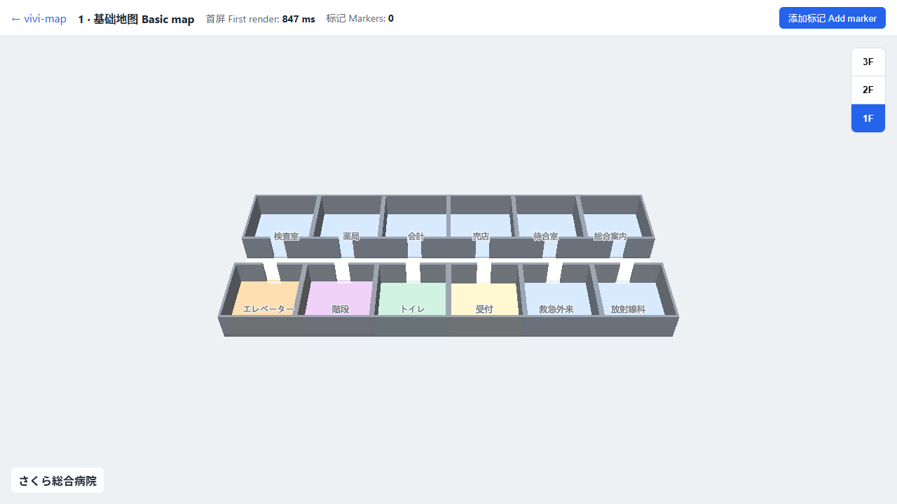

# vivi-map

开源的 TypeScript 室内地图 SDK（工作名 IndoorKit），配套示例画廊、实时定位看板与 AI 地图助手。

An open-source TypeScript indoor map SDK (working name IndoorKit), with a demo gallery, a real-time location dashboard, and an AI map assistant.

オープンソースの TypeScript 製屋内地図 SDK（仮称 IndoorKit）。デモギャラリー、リアルタイム位置情報ダッシュボード、AI 地図アシスタント付き。

**在线演示 / Live demo / オンラインデモ：<https://vivi-shiki.github.io/vivi-map/>**



## 当前进度：第 1 级（MVP）

- `@indoorkit/core`：`createIndoorMap`、类型安全插件 `definePlugin`、`ResourceTracker` 自动按逆序释放资源、`EventBus`、按数据类别生成样式
- `@indoorkit/imdf`：IMDF 读取与 zod 校验（含引用完整性、id 唯一性）
- `@indoorkit/plugins`：`floor`（楼层切换）、`marker`（标记）
- `tools/venue-gen`：生成虚构医院「さくら総合病院」1 栋 × 3 层
- Demo 1 基础地图、Demo 2 内存实验室；CI 中用 Playwright 做 50 轮创建/销毁的内存回归

## 开发

```bash
pnpm install
pnpm verify   # lint + typecheck + 单元测试
pnpm build    # 生成数据 + 构建
pnpm e2e      # 端到端与内存回归
```

## 路线图 / Roadmap / ロードマップ

- [中文](docs/roadmap.zh-CN.md)
- [English](docs/roadmap.en.md)
- [日本語](docs/roadmap.ja.md)

## 本地设计文档

完整的设计文档保存在本地文件 [改造项目文档.md](./改造项目文档.md)，已加入 `.gitignore`，不会被提交或推送到 GitHub。在 GitHub 上这个链接打不开是正常的。
