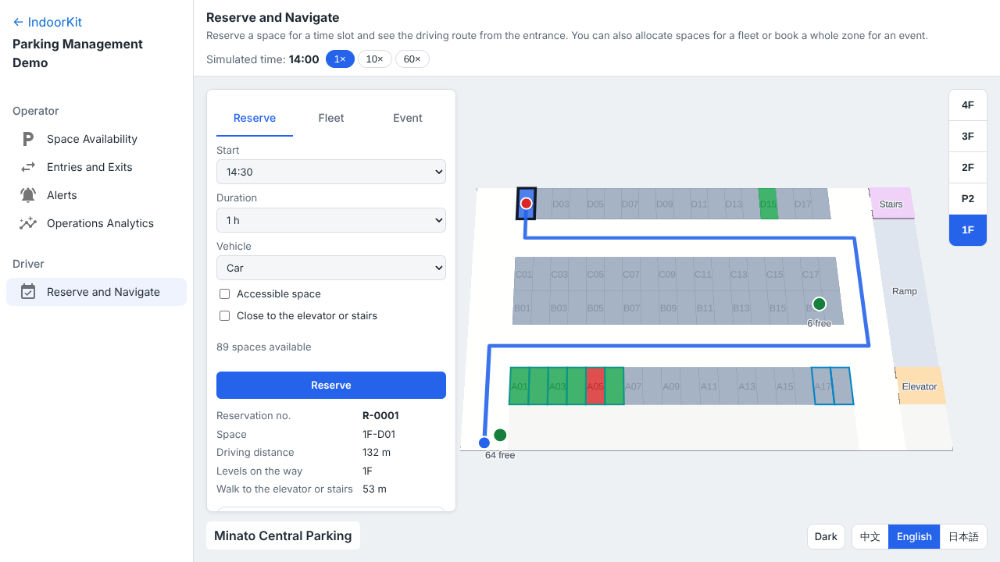
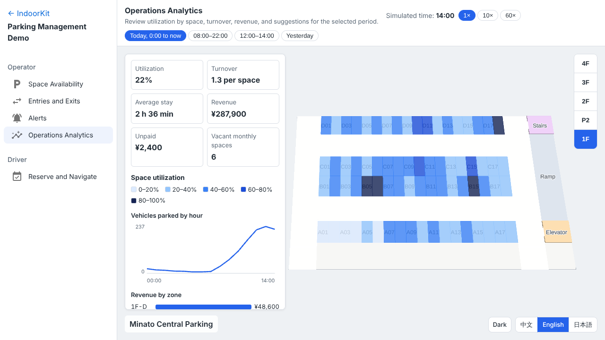

# IndoorKit — Hospital Indoor Positioning Demo

**English** | [简体中文](README.zh-CN.md) | [日本語](README.ja.md)

IndoorKit is an indoor mapping SDK built with TypeScript and MapLibre GL JS. This repository includes a hospital real-time location system (RTLS) demo and a parking management demo, both running entirely in the browser.

**Live demo: <https://vivi-shiki.github.io/IndoorKit/?lang=en>**

All people, equipment and buildings are fictional. The venue is "Sakura General Hospital": 3 buildings with 5 floors each, connected by bridges on every floor.

## Departments

In this demo, clinical, nursing, administrative, and service rooms are assigned to departments, such as emergency, internal medicine, surgery, or intensive care. A department may span multiple rooms, buildings, and floors. People and equipment also have an assigned department. Shared spaces such as corridors, elevators, and restrooms are not assigned to a department.

Alerts come from department zones, geofences, and device or person status. For each location update, the engine checks department zones, then geofences, and then status signals such as a device going offline or an SOS alert:

1. **Department zones**: for example a patient outside their assigned department for more than 30 s, a visitor entering a department they are not visiting, or a device taken out of its department.
2. **Geofences**: an ICU restricted zone with exemptions based on department, an alert when equipment enters a first-floor entrance area, and a visitor dwell limit for a patient room.
3. **Device and person status**: a device going offline, or a person sending an SOS alert.

## Medical Equipment

### Asset Tracking

View the equipment in each room, its current status, and its operating time today. The demo simulates operating, idle, offline, and maintenance states using a predefined schedule for each device.

- Equipment is grouped by room. Each room has a cluster marker whose color reflects the highest-priority equipment status in that room.
- The department list shows each department's equipment count and how many devices are offline or under maintenance. Select a department to highlight its rooms and list them.
- Click a room to see its equipment. Click a device to see its status, how long it has been in that status, its operating time today, its battery and its status history today.
- Search by equipment ID or type, and filter by status or type.


## People

### Live People Tracking

See where everyone is now. Simulated people move along corridors, enter and leave rooms through doorways, and move between floors using elevators or stairs.

- People are colored by person type (doctor, nurse, patient, visitor, care assistant, security guard) and can be filtered by type.
- People are listed by department, with how many are outside their assigned department.
- Search by name or ID, then select a result to switch to that person’s floor and follow their location. The person card shows their assigned department, their location and whether they are inside their assigned department, with a link to play back their location history.
- Choose 500, 2,000 or 5,000 simulated tags; positions are reported once per second and glide smoothly between reports. A performance panel shows frame rate, frame interval and the number of tags received.


### Location History Playback

See where someone has been. Pick a person and a period of 15, 30 or 60 minutes, and replay their movement at 1×, 4× or 16×.

- The map follows the person from floor to floor during the replay.
- Stops are listed with their time, room and duration, and marked when they are outside the person's assigned department. Click a stop to jump to that moment.
- Alerts along the route are listed below the stops.


### Alerts

A single list shows department zone, geofence, and status alerts, including the affected person or device, location, alert category, and severity.

- Mark each alert as acknowledged or resolved, and filter the list by alert category.
- Click the person or device in an alert to jump to its floor and position.


### Location Heatmap

Location records on each floor over the last 1, 5 or 15 minutes, filtered by person type, with the three rooms on the floor that have the most records. Colors represent the number of location records, not the number of people currently present.


### On every page

- Floor switching (1F–5F) across all buildings at once.
- Chinese, English and Japanese, including the room names drawn inside the map.
- Both themes target WCAG AA text contrast requirements. See the [contrast tests](apps/playground/e2e/theme-contrast.spec.ts) for the checks currently covered.
- Language and theme are remembered in the browser for the next visit.

## Parking Management

A second demo built on the same SDK, with its own business package. The fictional "Minato Central Parking" has a four-level garage (the fourth level is the rooftop) and a surface lot, with 332 spaces in total. A simulated day starts at 14:00 by default and runs at 1×, 10× or 60×. Plates are masked by default, and every plate and company is fictional.

### Space Availability

Each space is colored as available, occupied, reserved, needs attention, or detector offline when its sensor or camera is down. Monthly, EV charging, accessible and large-vehicle spaces have their own outline. The availability signs at the entrance and on each level show the same numbers as the map. Zones can be highlighted from the list, and device layers show space sensors, AI cameras with their coverage, EV chargers and CO sensors. Click a space for its plate, entry time, parking time and current fee.


### Entries and Exits

License plate reads at the entrance and exit, with vehicles parking and leaving, in one list of the latest 50 events. Vehicles driving on site move on the map. Search by plate to see the vehicle's space and a fee broken down into daytime and night periods, including the night maximum and the 24-hour maximum.

### Alerts

Alerts in three tiers: space use (a monthly, reserved, EV, accessible or large-vehicle space used by the wrong vehicle), parking time (unpaid exit, long-term parking, an EV left after charging, a reservation no-show, overnight parking) and equipment and environment (an offline sensor or camera, a gate or parking lock fault, a charger fault, a high CO level, an intercom help call). Mark each alert as acknowledged or resolved, filter by tier and severity, and open a recognition snapshot.

### Reserve and Navigate

Designed for phones. Reserve a space in 15-minute slots by vehicle type, an accessible space, or closeness to the elevator, and see the driving route from the entrance along the one-way lanes and ramps. The Fleet tab allocates spaces in a row for a company, starting with the large-vehicle zone, and the Event tab books a whole zone.



### Operations Analytics

Spaces are colored by utilization for today, daytime, lunchtime or yesterday, next to utilization, turnover, average stay, revenue, unpaid fees, vacant monthly spaces, vehicles parked by hour and revenue by zone. Suggestions from yesterday's data cover peak pricing, EV charging capacity and offering quiet zones as monthly parking.



## Technical highlights

- **Indoor map SDK with a plugin system.** `definePlugin` declares a plugin and its dependencies; plugins load in dependency order and their APIs are fully typed (`map.plugins.alarm.alarms()`).
- **Resource tracking and cleanup.** Every source, layer, listener, timer and Worker a plugin creates is registered with a `ResourceTracker` and released in reverse order by `destroy()`. A memory regression test switches through all pages repeatedly and checks the JS heap, Workers and registered resources.
- **Open data format.** Maps use IMDF (OGC Community Standard), validated with zod, including references between features and unique ids. Departments are an IMDF extension file that lists the rooms of each department; validation rejects unknown rooms and rooms claimed by two departments. The fictional hospital is generated by a script, so the data is reproducible.
- **Styles generated from data.** Room colors and 2.5D heights come from the room category and a theme; walls and rooms are extruded with `fill-extrusion`, no 3D models needed. Language and theme switch at runtime without recreating the map.
- **Position simulation in a Web Worker.** A deterministic, seeded simulator runs in a Web Worker and talks to the page through Comlink. The same ID is always the same person or device, with the same person type, department and status schedule.
- **Two-layer alert engine.** Each location update is checked against department zones first (outside the assigned department with a grace period, entering another department) and geofences second (restricted zone entry, dwell time exceeded, zone exit), with exemptions by department. Area rules raise an alert once per ongoing violation and can trigger again after the violation clears. Offline and SOS alerts are handled separately as status changes.
- **Spatial algorithms.** A Flatbush index plus point-in-polygon checks finds the room and department of every location update; interpolated movement with trail history and stop detection; per-room clustering by status; a heatmap that aggregates samples into per-minute grid buckets so memory stays bounded.
- **Tested end to end.** Unit tests run the SDK against an in-memory mock map without WebGL. Playwright tests drive the real pages through test hooks, check contrast in both themes, and measure heap growth through the Chrome DevTools Protocol. GitHub Actions runs everything and deploys to GitHub Pages.

## Tech stack

TypeScript (strict) · MapLibre GL JS · IMDF · zod · Web Worker + Comlink · KDBush · Flatbush · Turf · Vite · pnpm workspaces · Vitest · Playwright · Biome · GitHub Actions + GitHub Pages

## Project structure

| Path | Contents |
| --- | --- |
| `packages/core` | Map engine wrapper: map creation, camera, plugin system, resource tracking, events, style and theme generation. The only package that imports MapLibre |
| `packages/imdf` | IMDF loading, validation and conversion, with extension files for data outside the standard |
| `packages/rtls` | Real-time positioning contract: tag positions, data providers and the `positions:update` event |
| `packages/plugins` | Floor, zone, position stream, room cluster, unit state, route, trail, cluster, geofence, heatmap, polygon, line, popup and marker plugins. No hospital or parking concepts |
| `domains/hospital` | Hospital business logic without a map: departments (an IMDF extension), person types, equipment and statuses, and the two-layer alert engine |
| `domains/parking` | Parking business logic without a map: zones, devices and lanes (IMDF extensions), the tariff, the three-tier alert engine, lane routing, reservations and fleet and event bookings, statistics and suggestions |
| `tools/venue-gen` | Generator for the fictional hospital and its departments, and for the fictional parking garage |
| `tools/rtls-simulator` | Roster of people and devices, movement simulator and its Worker data provider |
| `tools/parking-simulator` | A seeded day of vehicles, reservations and device faults for the parking demo |
| `apps/playground` | The live demo, in React with MUI: a home page with the three use cases, then the five hospital pages behind a sidebar (top menu on phones). `engine/` loads MapLibre, `adapters/` connects the hospital domain and the simulator to SDK plugins, `presentation/` formats text and colors, `pages/` holds each page, `testing/` holds the test hooks. `parking/` holds the parking demo with the same structure, independent of the hospital pages |

## Run locally

Requires Node.js 22 and pnpm.

```bash
pnpm install
pnpm build
pnpm --filter playground preview
```

Then open <http://localhost:4173/IndoorKit/>.
