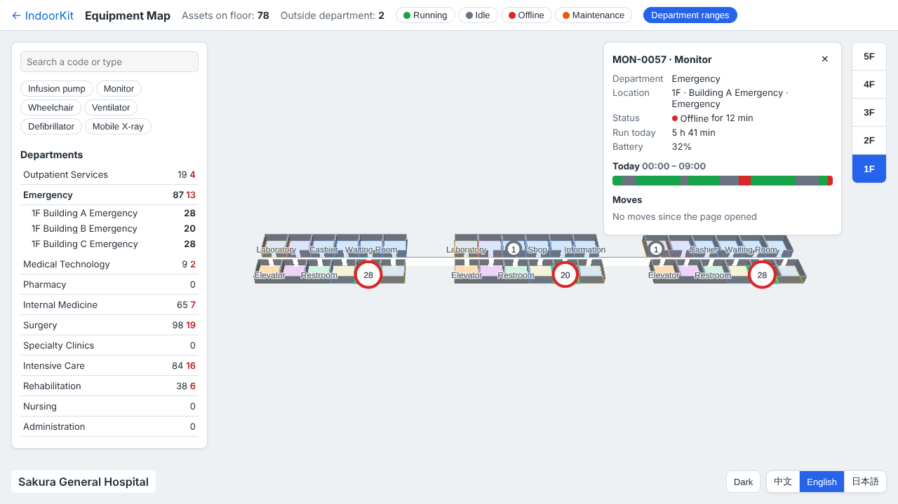
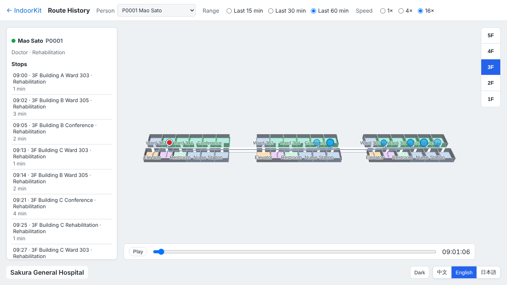
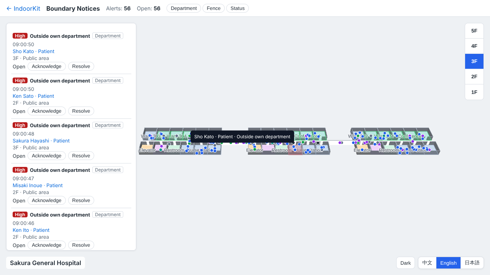
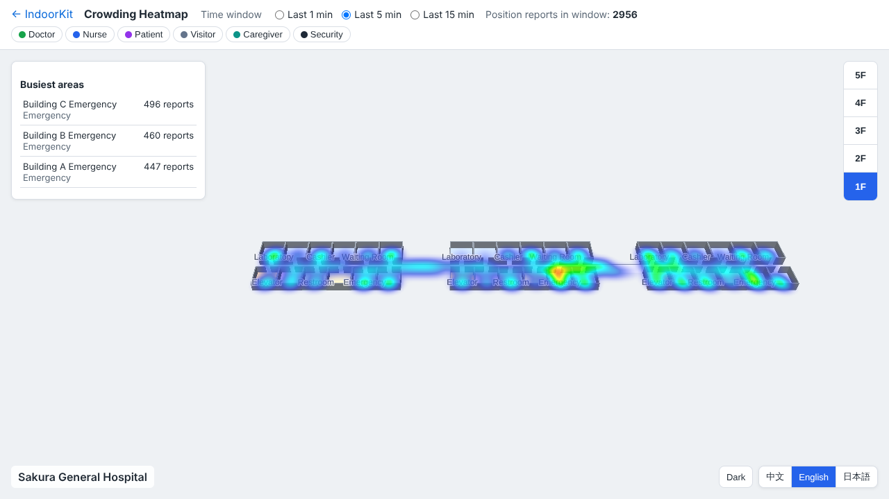

# IndoorKit — 医院室内地图看板

[English](README.md) | **简体中文** | [日本語](README.ja.md)

一个在浏览器里运行的医院室内定位（RTLS）演示。底层是用 TypeScript 从零编写、基于 MapLibre GL JS 的室内地图 SDK。

**在线演示：<https://vivi-shiki.github.io/IndoorKit/?lang=zh>**

所有人员、设备和建筑都是虚构的。场馆为「さくら総合病院」：3 栋楼、每栋 5 层，每层都有连廊相通。

## 科室

每个房间都属于一个科室，比如急诊科、内科、外科、重症医学科。一个科室可以包含多个房间，也可以跨楼栋、跨楼层。每台设备、每个人也都属于一个科室。走廊、电梯、洗手间等公共区域不属于任何科室。

报警先看科室范围，再看自定义围栏：

1. **科室范围**：例如患者离开本科室超过 30 秒、访客进入探视科室以外的科室、设备被带出本科室。
2. **自定义围栏**：ICU 禁入区（只允许 ICU 科室人员进入）、1F 出入口的设备防盗、病房探视时长。
3. **上报状态**：设备离线、人员按下一键求助。

## 设备视图

### 设备地图

某个房间里有哪些设备、现在状态如何、今天工作了多久。设备的运行状态（运行中、待机、离线、维修中）由设备上报，这里按每台设备的排班模拟。

- 设备按房间聚合，每个房间一个聚合点，颜色取房间内最严重的状态。
- 科室列表显示每个科室的设备数，以及离线和维修中的数量。选中科室会高亮它的房间并列出来。
- 点击房间查看其中的设备；点击设备查看状态、该状态持续了多久、今日运行时长、电量和今日状态时间轴。
- 可按设备编号或类型搜索，按状态或类型筛选。



## 人员视图

### 实时位置

每个人现在在哪。定位标签沿走廊行走、经门进出房间，只通过电梯或楼梯换层。

- 按角色着色（医生、护士、患者、访客、护工、安保），可按角色筛选。
- 按科室列出人员，并显示其中有多少人不在本科室。
- 搜索姓名或编号，跳到此人所在楼层并跟随。人员卡片显示所属科室、当前位置、是否在本科室，并可直接查看轨迹。
- 可选 500、2,000、5,000 个标签；每秒上报一次，两次上报之间平滑移动。性能面板显示帧率、帧间隔和在线标签数。


### 路线回看

一个人之前去过哪里。选择人员和近 15、30、60 分钟的范围，按 1×、4×、16× 倍速回放。

- 回放时地图跟着人切换楼层。
- 列出停留地点的时间、房间和停留时长，不在本科室的会标出来；点击停留地点跳到那个时刻。
- 停留地点下方列出途中触发的报警。



### 越界提醒

科室、围栏、状态三层报警在同一个告警流里，显示是谁、在哪、哪一层、什么级别。

- 每条告警可以确认或处理，可按层级筛选。
- 点击告警里的人员或设备，跳到所在楼层和位置。



### 拥挤热度

查看各楼层近 1、5、15 分钟内的人员密集区域，可按角色筛选，并列出本层最拥挤的三个房间。



### 所有页面通用

- 楼层切换（1F～5F），所有楼栋同时切换。
- 中文、英文、日文三语，地图内的房间名也一起切换。
- 亮色与暗色主题，两种主题下文字都满足 WCAG AA 对比度。
- 语言和主题保存在浏览器里，下次打开时保持不变。

## 技术要点

- **带插件系统的室内地图 SDK。** 用 `definePlugin` 声明插件及其依赖，按依赖顺序加载，插件 API 有完整的类型推导（如 `map.plugins.alarm.alarms()`）。
- **从设计上避免内存泄漏。** 插件创建的 source、图层、监听、定时器和 Worker 都登记到 `ResourceTracker`，`destroy()` 时按创建的逆序释放。内存回归测试会反复切换所有页面，检查 JS 堆、Worker 和已登记资源。
- **开放的数据格式。** 地图数据采用 IMDF（OGC 社区标准），用 zod 校验，包括要素之间的引用和 id 唯一性。科室是 IMDF 之外多加的一个文件，列出每个科室的房间；校验会拒绝不存在的房间和同时属于两个科室的房间。虚构医院由脚本生成，数据可以复现。
- **由数据生成样式。** 房间颜色和 2.5D 高度由房间类别和主题决定；墙体和房间用 `fill-extrusion` 拉伸，不需要 3D 模型。语言和主题在运行时切换，不重建地图。
- **实时数据不占主线程。** 可复现的定位模拟器（按种子生成）运行在 Web Worker 里，通过 Comlink 与页面通信。同一个编号永远是同一个人或同一台设备，角色、科室和状态排班都不变。
- **两层报警引擎。** 每次上报先按科室规则判断（离开本科室并超过宽限时间、进入其他科室），再按自定义围栏判断（禁入、滞留超时、离开区域），可按科室豁免。同一件事只报一次，人或设备回来后重置。
- **空间算法。** 用 Flatbush 索引加点在多边形内判断，确定每次上报所在的房间和科室；带轨迹记录和停留识别的插值移动；按房间、按状态聚合；热力图按「分钟 × 网格」累计样本，内存占用有上限。
- **端到端测试。** 单元测试在不依赖 WebGL 的内存假地图上运行 SDK。Playwright 通过测试钩子操作真实页面，检查两种主题下的对比度，并通过 Chrome DevTools Protocol 测量堆增长。GitHub Actions 运行全部测试并部署到 GitHub Pages。

## 技术栈

TypeScript（strict）· MapLibre GL JS · IMDF · zod · Web Worker + Comlink · KDBush · Flatbush · Turf · Vite · pnpm workspaces · Vitest · Playwright · Biome · GitHub Actions + GitHub Pages

## 目录结构

| 路径 | 内容 |
| --- | --- |
| `packages/core` | 地图创建、插件系统、资源登记、事件、样式与主题生成 |
| `packages/imdf` | IMDF 读取、校验与转换，包括科室 |
| `packages/plugins` | 楼层、科室、实时位置、房间聚合、轨迹、报警、聚合、电子围栏、热力图、多边形、线、弹窗、标记插件 |
| `tools/venue-gen` | 虚构医院及其科室的生成器 |
| `tools/rtls-simulator` | 人员与设备名册、移动模拟器及其 Worker 数据源 |
| `apps/playground` | 在线演示的五个页面 |

## 本地运行

需要 Node.js 22 和 pnpm。

```bash
pnpm install
pnpm build
pnpm --filter playground preview
```

然后打开 <http://localhost:4173/IndoorKit/>。
